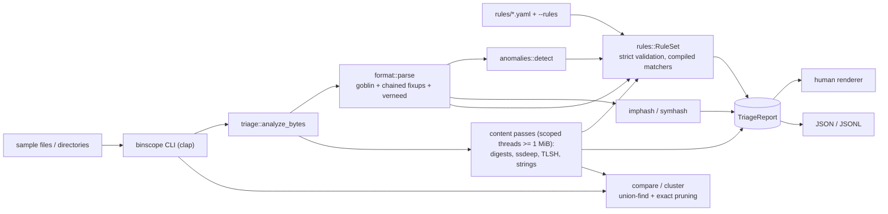

# binscope

Static triage for ELF, Mach-O and PE binaries in one Rust CLI: sections and
entropy, imports/exports, imphash, tagged strings, **ssdeep and TLSH that match
the reference tools byte for byte**, YAML capability rules with evidence, and
similarity clustering.

[](https://github.com/SlateGitOrg/binscope/actions/workflows/ci.yml)

binscope never runs, emulates or modifies what it inspects. It is a
defensive, offline first-look tool.

## Why

A first look at an unknown binary usually means running four or five tools
(`file`, `readelf`/`otool`/pefile, `strings`, `ssdeep`, `tlsh`, a capability
matcher) and joining their output by hand. binscope does that first pass in
one command, gives the same answers as those tools where they overlap, and
writes a JSON report that a pipeline can store and diff.

It is aimed at SOC and IR analysts doing first-pass triage, detection
engineers who want capability labels with evidence instead of a bare verdict,
and anyone learning binary formats who wants output they can check against
reference tools.

## Features

* **Formats:** ELF (32/64, any endianness), PE32/PE32+, Mach-O and universal
  Mach-O (one analysis per slice). Imports from Mach-O
  `LC_DYLD_CHAINED_FIXUPS` are decoded too; goblin skips them, and every
  arm64 binary built for macOS 12 or later stores its imports that way.
* **Structure:** sections with file and virtual ranges, permissions and
  Shannon entropy; entry point; imports attributed to libraries (PE import
  directory, ELF `.gnu.version_r`, Mach-O dylib ordinals); exports and PE
  forwarders; overlays; hardening (ASLR/NX/CFG/signature for PE,
  PIE/NX/RELRO/canary/fortify for ELF, PIE/NX-stack/code signature for Mach-O).
* **Hashes:** MD5/SHA-1/SHA-256, imphash (pefile-compatible, including
  pefile's ordinal tables), symhash for ELF/Mach-O, **ssdeep** and **TLSH**.
* **Strings:** ASCII and UTF-16LE in one pass each. Each string is mapped to
  its section and tagged when it looks like a URL, IPv4 address, e-mail
  address, Windows/Unix path, registry key, library name or base64 run.
* **Anomalies:** high-entropy sections or files, W+X sections, entry point
  outside any section or in a writable one, virtual-only executable sections,
  sections past EOF, overlays, images with no imports, nonstandard PE section
  names.
* **Capability rules:** 34 built-in YAML rules (networking, file system,
  processes, registry, services, code loading, crypto, compression,
  anti-debugging checks, packing). Leaves are import, library, export,
  string, regex, tag, section, anomaly and format; combinators are `all`,
  `any`, `not` and `at_least`. Rule files are validated strictly, and every
  match reports the evidence behind it.
* **Similarity:** `compare` takes two files or two digests. `cluster` groups
  a sample set by single linkage on TLSH distance or ssdeep score. Candidate
  pruning is exact (property-tested against brute force) and each cluster
  reports its medoid.
* **Output:** terminal (colour optional; control characters from the sample
  are escaped), JSON and JSONL. `--fail-on <severity>` exits with status 3 so
  a pipeline can gate on findings.

## Architecture



Everything is one crate (library + `binscope` binary), synchronous and
in-process, with no network access. `triage::analyze_bytes` is the core: the
format layer builds a format-neutral `BinaryInfo`, four whole-file passes
(digests, ssdeep, TLSH, strings) run in parallel for inputs of 1 MiB or more,
and the rule engine evaluates over imports, strings, sections and anomalies.
A malformed file still gets hashes, strings and content rules, and a panic
inside the container parser becomes a per-file error instead of aborting a
batch.

Module map, algorithms and complexity: [docs/ARCHITECTURE.md](docs/ARCHITECTURE.md).
Threat model: [docs/THREAT_MODEL.md](docs/THREAT_MODEL.md).

## Quick start

Prerequisites: Rust 1.88 or newer (CI builds on 1.88 and current stable),
GNU make, and `python3` for `make demo`. `make check` additionally needs
[cargo-llvm-cov](https://github.com/taiki-e/cargo-llvm-cov)
(`cargo install cargo-llvm-cov --locked`). Everything runs offline against
the fixture corpus committed in `fixtures/bin`.

```sh
cargo build --release --locked
./target/release/binscope triage fixtures/bin/pe-x86_64/net-v0.exe
./target/release/binscope cluster fixtures/bin/elf-x86_64
make demo          # end-to-end run over the bundled fixtures
cargo test --locked
make check         # fmt, clippy, rustdoc, tests under coverage (needs cargo-llvm-cov)
```

## Usage

```sh
B=target/release/binscope
$B triage sample.exe                          # human report
$B triage --json sample.exe                   # JSON report (array for several files)
$B triage --jsonl --fail-on medium samples/   # one object per line; exit 3 on a medium+ finding
$B triage --rules my-rules/ sample.exe        # built-in pack plus your rules
$B hash samples/                              # md5, sha256, imphash|symhash, ssdeep, tlsh (TSV)
$B compare a.bin b.bin                        # or two ssdeep / TLSH digests
$B cluster --method tlsh --threshold 70 samples/
$B strings --tagged-only sample.exe
$B rules list --rules my-rules/
$B rules check my-rules/                      # validate rule files only
```

Exit status: 0 success, 1 error, 2 usage error, 3 a `--fail-on` threshold was
reached. Directories are walked recursively without following symlinks.

| make target | what it does |
|---|---|
| `make check` | rustfmt check, clippy (pedantic, `-D warnings`), rustdoc `-D warnings`, the full test suite under cargo-llvm-cov with an 85% line floor |
| `make test` | the test suite without coverage |
| `make demo` | offline end-to-end run over the bundled fixtures |
| `make bench` / `make eval` | throughput benchmark / clustering evaluation |
| `make loc` | non-test source line count |
| `make reference` | rebuild ssdeep, TLSH and pefile in a temp dir and regenerate `tests/reference/` (needs network) |
| `make fixtures` | rebuild the fixture corpus from C sources (needs macOS: clang, rust-lld, lipo) |

## Example output

Captured from `make demo`. Only some of its steps are shown; the full run
also triages a universal Mach-O, hashes a directory and lists the rules.

```text
$ binscope triage --max-strings 8 fixtures/bin/pe-x86_64/net-v0.exe
== fixtures/bin/pe-x86_64/net-v0.exe ==
  size       2048 bytes, entropy 3.122 (text/structured)
  md5        c90d62571e13c7f546944499a74881e0
  sha256     a73728f9e6926a8acc9ee518a6ddd1e37759bd1c41a0f983b4cb1def5c391c5b
  imphash    f04dc4e4de74d69dc61cdf0ce8598b2c
  ssdeep     24:vpmGSugUBchoWhHXr2GpAutcwiWCUW6NUW6bBLOA:vpguBBhWhXlFkW1W6aW6bBL
  tlsh       T1B941CC03F27469EEC0094B77D3872EC17679231443A61ADF5B3448696D613FF68B8B40

PE x86_64  64-bit little-endian executable
  entry 0x140001000 (.text)

Sections (2)
  name       offset     size              vaddr perm entropy
  .text       0x400      512        0x140001000 r-x    4.288 #####..... text/structured
  .rdata      0x600      512        0x140002000 r--    3.216 ####...... text/structured

Imports (10 from 2 libraries)
  kernel32.dll: ExitProcess, GetStdHandle, WriteFile
  ws2_32.dll: WSACleanup, WSAStartup, closesocket, connect (#4), htons (#9), send (#19), socket (#23)

Mitigations: aslr yes | high-entropy-va yes | nx yes | cfg no | signed no

Anomalies (0)

Capabilities (4)
  [low]    connect to a network endpoint over sockets (communication/socket) [T1071]
           import ws2_32.dll!socket; import ws2_32.dll!connect
  [info]   send or receive data on a socket (communication/socket)
           import ws2_32.dll!send
  [info]   initialize Winsock (communication/socket)
           import ws2_32.dll!WSAStartup
  [info]   write to the console (host-interaction/console)
           import kernel32.dll!GetStdHandle; import kernel32.dll!WriteFile

Strings: 19 ASCII, 0 UTF-16LE; tagged: library-name 2
     0x7bc a .rdata           "kernel32.dll" [library-name]
     0x7c9 a .rdata           "ws2_32.dll" [library-name]
      0x4d a -                "!This program cannot be run in DOS mode.$"
     0x180 a -                ".text"
     0x1a7 a -                "`.rdata"
     0x420 a .text            "AWAVVWSH"
     0x457 a .text            "T$@f"
     0x48e a .text            "T$0H"
  (listing truncated; use --max-strings or the strings command)
```

```text
$ entropy contrast: same program, blob stored plain vs zlib-compressed
== fixtures/bin/elf-x86_64/plainblob-v0 ==
  .blob               0x380    24576           0x200380 r--    4.258 #####..... text/structured
== fixtures/bin/elf-x86_64/packed-v0 ==
  .blob               0x380     4583           0x200380 r--    7.959 ########## compressed/encrypted
  [medium] high-entropy-section                 section .blob has entropy 7.96 over 4583 bytes
  [medium] contains compressed or encrypted data (executable/packing)
```

```text
$ binscope triage --json fixtures/bin/macho-arm64/net-v0 (excerpt: imports + capabilities)
{
  "format": "macho",
  "arch": "aarch64",
  "chained_fixups": true,
  "imports": [
    "_close",
    "_connect",
    "_htons",
    "_puts",
    "_send",
    "_socket"
  ],
  "symhash": "3b80441525cf996e9c4b5944e64b0c9b",
  "tlsh": "T186E21E27DF5C4AB1D02C8B38C1B70B872B25F1A243EF53270B55D068BEC5366AC61896",
  "capabilities": [
    "communication.socket.tcp-client",
    "communication.socket.send-receive",
    "host.console.output"
  ]
}
```

```text
$ binscope compare fixtures/bin/pe-x86_64/net-v0.exe fixtures/bin/pe-x86_64/net-v1.exe
a  fixtures/bin/pe-x86_64/net-v0.exe
b  fixtures/bin/pe-x86_64/net-v1.exe
ssdeep score   0 / 100 (higher = more similar)
tlsh distance  112 (lower = more similar)
imphash        identical

$ binscope cluster fixtures/bin/elf-x86_64
Clustering: 20 samples, 3 clusters, 10 singletons, 0 without a digest (TLSH distance <= 70; single linkage)
compared 78 of 190 pairs after exact pruning

cluster 1 (4 members, medoid fixtures/bin/elf-x86_64/net-v2)
    fixtures/bin/elf-x86_64/net-v0
    fixtures/bin/elf-x86_64/net-v1
  * fixtures/bin/elf-x86_64/net-v2
    fixtures/bin/elf-x86_64/net-v3

cluster 2 (4 members, medoid fixtures/bin/elf-x86_64/plainblob-v2)
    fixtures/bin/elf-x86_64/plainblob-v0
    fixtures/bin/elf-x86_64/plainblob-v1
  * fixtures/bin/elf-x86_64/plainblob-v2
    fixtures/bin/elf-x86_64/plainblob-v3

cluster 3 (2 members, medoid fixtures/bin/elf-x86_64/hello-v2)
  * fixtures/bin/elf-x86_64/hello-v2
    fixtures/bin/elf-x86_64/hello-v3

singletons
    fixtures/bin/elf-x86_64/files-v0
    fixtures/bin/elf-x86_64/files-v1
    fixtures/bin/elf-x86_64/files-v2
    fixtures/bin/elf-x86_64/files-v3
    fixtures/bin/elf-x86_64/hello-v0
    fixtures/bin/elf-x86_64/hello-v1
    fixtures/bin/elf-x86_64/packed-v0
    fixtures/bin/elf-x86_64/packed-v1
    fixtures/bin/elf-x86_64/packed-v2
    fixtures/bin/elf-x86_64/packed-v3

$ binscope triage --fail-on medium (CI gate) on a packed sample
exit status: 3
```

## Writing rules

```yaml
rules:
  - id: communication.socket.tcp-client
    name: connect to a network endpoint over sockets
    namespace: communication/socket
    severity: low
    attack: [T1071]
    match:
      all:
        - import: socket                  # glob-capable, case-insensitive
        - any:
            - import: connect
            - import: 'ws2_32!WSAConnect*' # library-qualified
  - id: executable.packed-or-compressed-section
    name: contains compressed or encrypted data
    namespace: executable/packing
    severity: medium
    match:
      section: {min_entropy: 7.2, min_size: 1024}
```

Other leaves: `library`, `export`, `string` (case-insensitive substring),
`string_regex`, `string_tag` (`url`, `ipv4`, `email`, `windows-path`,
`unix-path`, `registry`, `library-name`, `base64-like`), `anomaly` (ids in
`src/anomalies.rs`) and `format`. A rule-level `formats: [pe]` restricts where
the rule applies. Unknown keys, bad regexes, unknown tags or anomaly ids and
duplicate ids fail the load and name the file and the rule. The built-in pack
lives in [rules/](rules/) and is compiled into the binary.

## How it works

The algorithms (one-pass ssdeep over all 31 block sizes, TLSH quartile
encoding and distance, rule compilation, string-to-section attribution and the
clustering pruning bounds) are described with their complexity in
[docs/ARCHITECTURE.md](docs/ARCHITECTURE.md). This section collects the
evidence for them.

### Verified against reference tools

`tests/reference_vectors.rs` checks binscope against output committed from
the real tools. The vectors cover all 121 fixtures plus 132 synthetic inputs
from 0 bytes to 3.5 MB, which the tests regenerate deterministically. The
vectors are produced by `scripts/reference/`, which builds each tool from a
checksummed source release in a temporary directory.

| check | reference | cases | result |
|---|---|---:|---|
| ssdeep digests | ssdeep 2.14.1 `ssdeep -s -c` | 253 | identical |
| ssdeep scores | libfuzzy `fuzzy_compare` | 1,587 pairs | identical |
| TLSH digests (incl. "no digest" cases) | TLSH 4.12.1 | 253 | identical |
| TLSH distances (with and without length) | `Tlsh::totalDiff` | 1,587 pairs x 2 | identical |
| imphash | pefile 2024.8.26 `get_imphash()` | 40 PE files | identical |
| PE section names, raw sizes, entropy | pefile `get_entropy()` | 116 sections | equal (abs. error < 1e-9) |
| ELF / Mach-O section tables | `llvm-readobj --sections` | 80 files | identical (name, offset, size, address) |
| ELF / Mach-O imported symbols | `llvm-nm` (undefined) | 80 files | identical sets |

Command: `cargo test --release --test reference_vectors` (also part of
`make check`).

### Benchmarks

`make bench` (= `cargo run --release --example throughput`). Apple M1 Pro,
release build, best of 5 runs. The machine was shared with other builds
(1-minute load average 3.63 5.73 4.84 at the start), so treat these numbers
as indicative.

| operation | time (ms) | MiB/s |
|---|---:|---:|
| entropy (Shannon) | 26.3 | 1217.8 |
| strings (ASCII + UTF-16LE) | 142.4 | 224.7 |
| md5 + sha1 + sha256 | 80.2 | 399.2 |
| ssdeep digest | 196.8 | 162.6 |
| tlsh digest | 187.1 | 171.0 |
| full triage (non-executable input) | 251.4 | 127.3 |

fixture corpus: 121 files, 1.91 MiB, full triage in 44.3 ms (2734 files/s, 43.2 MiB/s)

| clustering 2000 samples | pruned: pairs scored | pruned: ms | brute force: pairs | brute force: ms | clusters |
|---|---:|---:|---:|---:|---:|
| Tlsh (threshold 70) | 1510552 | 66.2 | 1999000 | 80.0 | 126 |
| Ssdeep (threshold 40) | 7000 | 53.9 | 1999000 | 1611.4 | 250 |

* All passes are single-pass O(n). "Full triage" on a large input runs the
  digest, ssdeep, TLSH and string passes on four scoped threads, so it takes
  about as long as the slowest of them plus rule evaluation. Before the
  passes were parallelised, the same command measured 49.7 MiB/s.
* The fixture corpus is many tiny files, so there per-file overhead
  (parsing, 34 rules, report assembly) dominates.
* Clustering: the ssdeep 7-gram index scores 0.35% of all pairs and returns
  exactly the brute-force result. On equally sized inputs TLSH's
  length-bucket bound prunes only about a quarter of the pairs, so TLSH
  clustering stays close to quadratic; at O(32) per pair that is still
  cheap at this scale.

### Clustering evaluation: what fuzzy hashes can and cannot do

`make eval` (= `cargo run --release --example cluster_eval`). The default
thresholds (TLSH <= 70, ssdeep >= 40) were fixed before this evaluation ran
(see [DECISIONS.md](DECISIONS.md)). The sweep below is a sensitivity analysis
on the same corpus, not tuning.

**On the fixture corpus.** Ground truth comes from `fixtures/MANIFEST.tsv`.
Under "program+target", the four variants of one program built for one target
form a group. Under "program only", all builds of a program form one group,
across targets. Scores are pairwise precision, recall and F1, plus the
adjusted Rand index.

| method | truth | clusters | pair precision | pair recall | pair F1 | ARI |
|---|---|---:|---:|---:|---:|---:|
| Tlsh 70 | program+target | 20 | 0.292 | 0.472 | 0.361 | 0.341 |
| Tlsh 70 | program only | 20 | 0.863 | 0.179 | 0.296 | 0.246 |
| Ssdeep 40 | program+target | 20 | 0.261 | 0.439 | 0.327 | 0.306 |
| Ssdeep 40 | program only | 20 | 0.789 | 0.170 | 0.280 | 0.227 |

Sensitivity (truth = program+target):

| method | threshold | clusters | precision | recall | F1 | ARI |
|---|---:|---:|---:|---:|---:|---:|
| Tlsh | 10 | 4 | 0.000 | 0.000 | 0.000 | -0.003 |
| Tlsh | 20 | 5 | 0.143 | 0.022 | 0.038 | 0.032 |
| Tlsh | 30 | 8 | 0.256 | 0.183 | 0.214 | 0.197 |
| Tlsh | 50 | 14 | 0.288 | 0.378 | 0.327 | 0.307 |
| Tlsh | 70 | 20 | 0.292 | 0.472 | 0.361 | 0.341 |
| Tlsh | 100 | 21 | 0.192 | 0.683 | 0.300 | 0.272 |
| Tlsh | 150 | 8 | 0.121 | 1.000 | 0.215 | 0.179 |
| Tlsh | 200 | 4 | 0.088 | 1.000 | 0.162 | 0.122 |
| Ssdeep | 1 | 20 | 0.273 | 0.467 | 0.344 | 0.323 |
| Ssdeep | 10 | 20 | 0.273 | 0.467 | 0.344 | 0.323 |
| Ssdeep | 20 | 20 | 0.273 | 0.467 | 0.344 | 0.323 |
| Ssdeep | 30 | 20 | 0.273 | 0.467 | 0.344 | 0.323 |
| Ssdeep | 40 | 20 | 0.261 | 0.439 | 0.327 | 0.306 |
| Ssdeep | 60 | 20 | 0.271 | 0.256 | 0.263 | 0.245 |
| Ssdeep | 80 | 15 | 0.076 | 0.056 | 0.064 | 0.044 |

What the clusters actually contain (`binscope cluster fixtures/bin`):

* The largest cluster holds 20 `plainblob` builds from five targets (all
  but `macho-arm64`). The 24 KiB generated-text blob outweighs everything
  else in those files, and the four text variants share one vocabulary.
* The second largest holds 10 `macho-arm64` builds of three different
  programs (`hello`, `net`, `files`). Most of their bytes are 16 KiB page
  padding and identical load commands.
* The `packed` variants are mostly singletons. Their compressed blobs differ
  per variant and dominate the file, and the same variant built for
  different targets links up instead.
* On binaries this small (2–66 KB), toolchain boilerplate and embedded data
  outweigh the code. Neither hash recovers program families well here
  (best F1 ≈ 0.36). That limit belongs to byte-level similarity on tiny
  files, not to the implementation: the digests match the reference tools
  exactly.

**Edit robustness (synthetic).** Each of 60 random, mixed or text bases
(64 KiB, from `binscope::synth`) is compared with an edited copy of itself,
and every base with every other base. Synthetic data stands in for real code
changes here; it is not real malware or software. The first table is the
share of (original, edited copy) pairs each hash links at its default
threshold.

| edit | bytes rewritten | TLSH <= 70 | ssdeep >= 40 | median TLSH | median ssdeep |
|---|---:|---:|---:|---:|---:|
| contiguous 1% | 655 | 100% | 100% | 7 | 97 |
| contiguous 5% | 3276 | 100% | 100% | 24 | 94 |
| contiguous 20% | 13107 | 30% | 100% | 88 | 82 |
| dispersed 0.1% | 73 | 100% | 25% | 4 | 0 |
| dispersed 1% | 759 | 100% | 0% | 10 | 0 |
| dispersed 5% | 3404 | 73% | 0% | 59 | 0 |

Links between *different* bases (false links at the default thresholds):

| base kinds | pairs | TLSH <= 70 | ssdeep >= 40 |
|---|---:|---:|---:|
| different kinds | 1200 | 0 | 0 |
| mixed vs mixed | 190 | 190 | 0 |
| random vs random | 190 | 0 | 0 |
| text vs text | 190 | 189 | 0 |

The two hashes fail in opposite ways. ssdeep survives large contiguous edits
but drops to 0 once edits are spread out, because no 7-character run of its
digest survives. TLSH tolerates spread-out edits, but it also links files
that share only byte statistics (same-vocabulary text, same block layout).
That is why binscope reports both.

### Design decisions

Each ruling, with its reason and its cost if wrong, is in
[DECISIONS.md](DECISIONS.md). The main ones:

* Both ssdeep and TLSH are implemented, and libfuzzy and TLSH 4.12.1
  behaviour is reproduced bit for bit, including libfuzzy's block-size
  elimination and TLSH's integer length buckets.
* Reference outputs are committed as vectors, so `make check` stays offline.
* The fixtures are built in the repo from freestanding C with clang and
  rust-lld, against a stub `libc.so.6` and `.def` import libraries. No
  binaries are downloaded and there are no packers.
* Mach-O chained fixups are decoded in house. ELF imports are attributed to
  libraries via symbol versioning.
* Clustering uses exact pruning only, never approximate indexes, so results
  are reproducible and testable.
* `unsafe` is forbidden crate-wide, every file-derived offset is clamped, and
  parser panics are caught per file ([docs/THREAT_MODEL.md](docs/THREAT_MODEL.md)).

## Testing

```sh
cargo test --locked                               # everything
cargo test --release --test reference_vectors     # reference-tool vectors only
make check                                        # the full gate, as CI runs it
```

The suite (127 tests) is inline unit tests plus four integration suites:

* `tests/fixtures.rs` checks every fixture's sha256 against
  `fixtures/MANIFEST.tsv` and its expected format and architecture, the
  imports and capabilities of each program, both Mach-O import encodings, the
  entropy contrast and JSON round trips. It also triages 492 truncated or
  bit-flipped variants of real fixtures and requires a report (never a crash)
  for each.
* `tests/cli.rs` drives the built binary: triage in human, colour, JSON and
  JSONL modes, `--fail-on` exit codes, extra and disabled rule packs, `hash`,
  `compare` on files and on digests, `cluster`, `strings` filters, and the
  error for a missing input.
* `tests/properties.rs` (proptest): entropy bounds, string extraction
  fidelity, ssdeep/TLSH streaming == one-shot, digest round trips, metric
  symmetry, parser robustness on random bytes behind real magic numbers, and
  clustering-with-pruning == brute force on random corpora.
* `tests/reference_vectors.rs`: the reference-tool comparison above.

Coverage is gated at 85% of lines in `make check`. The figure comes from:

```sh
cargo llvm-cov --summary-only --ignore-filename-regex '(hashes/ordinals|fuzzy/tlsh_tables)\.rs'
```

| scope | lines | line coverage |
|---|---:|---:|
| whole crate (generated tables excluded), the gated figure | 3,926 | **94.47%** |
| core logic (excluding `main.rs`, `report.rs`, `synth.rs`) | 3,317 | 95.15% |
| lowest module: `format/elf.rs` (rare section-less / RELRO branches) | 209 | 82.78% |

Lines are as llvm-cov counts them. `make loc` counts non-blank, non-comment
lines outside `#[cfg(test)]` modules: **4,023 lines of non-test Rust**
(generated tables excluded), plus 1,178 lines of inline unit tests and 701
lines of integration tests.

CI ([.github/workflows/ci.yml](.github/workflows/ci.yml)) runs the same gates:
rustfmt and clippy/rustdoc, the test suite on Linux and macOS, the coverage
floor, a build on the 1.88 MSRV, and the offline demo plus a quick benchmark.

## Project layout

```text
src/            library + CLI
  format/       ELF, PE, Mach-O parsing (goblin + chained fixups, verneed, mitigations)
  fuzzy/        ssdeep and TLSH
  hashes/       file digests, imphash (+ generated ordinal tables), symhash
  rules/        YAML schema, validation, compilation and evaluation
  triage.rs     orchestration and report type; cluster.rs, report.rs, strings.rs, entropy.rs, anomalies.rs
rules/          built-in YAML capability rules (compiled into the binary)
fixtures/       C sources, build script, 121 committed binaries + MANIFEST.tsv
tests/          fixture, CLI, property and reference-vector suites; reference/*.tsv
examples/       throughput, cluster_eval, gen_synth, fuzzy_hash
scripts/        demo, LOC, reference-tool builders, table generators
docs/           ARCHITECTURE.md, THREAT_MODEL.md
```

## Limitations

* **Tiny fixtures.** The corpus is 121 benign programs of 2–66 KB built by
  one toolchain. It exercises the parsers and the rules but says little about
  real-world software. The clustering numbers above show that directly.
* **No real packed samples.** The "packed" family is a zlib blob in a data
  section, not a binary packed by UPX or another packer. The packer-layout
  rule (W+X, virtual-only sections, entry point in a writable section) is
  checked only by unit tests with synthetic section tables.
* **Rules are static and import-based.** Dynamic API resolution, syscall
  stubs, obfuscated strings and runtime decryption all evade them. ATT&CK
  ids are coarse labels, not coverage claims. No rule-pack precision or
  recall has been measured on labelled data, because there is no such
  dataset in this repo.
* **Formats.** COFF objects, TE images, `ar` archives, .NET metadata,
  resources, Authenticode verification and DWARF are out of scope. The
  signature mitigation only reports that a certificate table exists. ELF
  imports without symbol versioning are unattributed.
* **symhash** for ELF/Mach-O is not validated against an external tool.
  Only imphash (PE) is.
* **Whole-file reads.** Inputs are read fully into memory, with no size cap
  and no mmap. Clustering is O(n²) in the worst case, and the TLSH pruning
  is weak on equally sized inputs.
* **Parser trust.** goblin does the container parsing. binscope catches its
  panics, but it has not been fuzzed beyond 492 deterministic mutations and
  proptest's garbage-behind-magic cases.
* **Fixture rebuilds** need macOS (clang, rust-lld, lipo). A different
  toolchain version produces different bytes, after which the reference
  vectors must be regenerated.

## Roadmap

* A VP-tree or LSH-bucket index for TLSH, to cluster 10^6 samples without
  quadratic scans.
* PE resources, Authenticode verification, Rich header and .NET metadata.
* Per-section fuzzy hashes, so similarity is measured on code rather than
  padding and data.
* Measure rule precision and recall on a labelled, licence-clean corpus of
  real software.
* A fuzzing harness (cargo-fuzz) over `format::parse` and the digest parsers.
* A streaming mode with mmap and a size cap for very large inputs.

## License

MIT — see [LICENSE](LICENSE). Third-party data (TLSH constant tables, pefile
ordinal tables) and the reference-tool provenance are listed in
[DATA.md](DATA.md).
