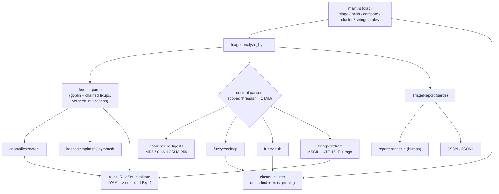

# binscope architecture

binscope is a single Rust crate (library + `binscope` binary). Everything is
synchronous and in-process; there is no daemon, database or network access.

## Module map

| module | responsibility |
|---|---|
| `format/mod.rs` | format-neutral model (`BinaryInfo`, `Section`, `Import`, ...), magic detection, panic-safe dispatch to goblin |
| `format/elf.rs` | sections (PT_LOAD fallback), dynamic imports with `.gnu.version_r` library attribution, exports, PIE/NX/RELRO/canary/fortify |
| `format/pe.rs` | sections, import directory in pefile order (ordinals resolved), exports/forwarders, DllCharacteristics, certificate table, PDB path |
| `format/macho.rs` | per-slice analysis, `LC_DYLD_CHAINED_FIXUPS` import decoder, bind-opcode and symbol-table fallbacks, UUID / min-OS / code signature |
| `entropy.rs` | Shannon entropy, histograms, windowed entropy |
| `strings.rs` | single-pass ASCII and UTF-16LE extraction, indicator tagging via one `RegexSet` |
| `hashes/` | file digests, pefile-compatible imphash (+ generated ordinal tables), symhash |
| `fuzzy/ssdeep.rs` | CTPH digest engine and `fuzzy_compare` |
| `fuzzy/tlsh.rs` | TLSH T1 digest, hex codec, distance |
| `anomalies.rs` | structural heuristics with stable ids |
| `rules/` | YAML schema, strict validation and compilation (`mod.rs`); evaluation with evidence (`eval.rs`) |
| `triage.rs` | orchestration, string-to-section attribution, report type |
| `cluster.rs` | candidate generation, union-find, medoids, ARI / pair confusion |
| `report.rs` | terminal rendering (control-character escaping) |
| `synth.rs` | deterministic synthetic data for tests, benchmarks and reference vectors |

## Key algorithms

### ssdeep (context-triggered piecewise hashing)

A 7-byte rolling hash `r(p)` (Adler-style sums plus a shift-xor term) marks a
*trigger* at position `p` for block size `b` when `(r(p) + 1) mod b == 0`.
Between triggers an FNV-style hash accumulates; at each trigger its low six
bits become one base64 character. Because only six bits are ever used and
`(h * PRIME ^ c) mod 64` depends only on `h mod 64`, the per-block state is
kept reduced to six bits (the same trick ssdeep >= 2.13 uses).

All 31 block sizes `3 * 2^k` are computed in **one pass**: a block context is
forked when the previous one emits its first character, and the smallest is
dropped once it is provably unusable (it is full and the next block size
already has >= 32 characters, and the input is larger than `3 * 2^k * 64`).
The digest takes the smallest block size whose signature has >= 32 characters
(starting from `bs * 64 >= size`), plus a truncated signature at twice that
block size.

Comparison: block sizes must be equal or differ by 2x; runs of more than three
identical characters are collapsed; two parts score 0 unless they share a
7-character substring; otherwise the weighted edit distance (insert 1,
delete 1, replace 2) is rescaled to 0..100, capped for small block sizes.

* digest: O(n) time, O(1) space (31 x 64-byte contexts)
* compare: O(64 * 64)

### TLSH

For every byte after the fourth, six salted Pearson hashes over byte triplets
from a 5-byte window increment one of 256 buckets (only the first 128 are
used); a Pearson chain keeps a 1-byte checksum. The quartiles q1 <= q2 <= q3 of
the 128 counts quantise each bucket to two bits (32-byte body). The header
holds the checksum, a log-scale length bucket (`topval` table, binary search)
and `q1/q3`, `q2/q3` ratios mod 16. Distances add a header term (length and
ratio differences, 12x weighting beyond +-1) to a body term from a
compile-time 256x256 table of 2-bit-pair differences (a full 0<->3 flip costs
6).

* digest: O(n) time, O(1) space; quartiles by sorting 128 counters
* distance: O(32) table lookups

### Clustering with exact pruning

Samples are nodes; an edge joins pairs within threshold; clusters are
connected components (single linkage) found with a union-find (path halving,
union by size: near-O(1) amortised per operation). Medoid = member with the
smallest summed distance to the other members (O(m^2) per cluster).

Scoring all n(n-1)/2 pairs is avoided without changing the result:

* **ssdeep**: `compare` is 0 unless two parts at the same effective block size
  share a 7-gram, or the digests are identical. An inverted index keyed by
  `(effective block size, 7-gram)` (plus an exact-digest index) yields
  precisely the pairs that can score above zero. Cost: O(n * 64) to index
  plus the candidate pairs; worst case still O(n^2) if every digest shares a
  gram.
* **TLSH**: the length term alone is a lower bound of the full distance
  (`12 * |dL|` once `|dL| > 1`). Samples are bucketed by length value and only
  bucket pairs whose bound is within the threshold are expanded.

Both are property-tested against brute force (`tests/properties.rs`). The
benchmark (`make bench`) shows the ssdeep index scoring ~0.35% of all pairs;
the TLSH bound prunes far less on corpora of similar sizes (~25% in the
benchmark), so TLSH clustering stays effectively quadratic, which is cheap at
O(32) per pair for thousands of samples.

### Rules

YAML is deserialised with `deny_unknown_fields` into a definition tree, then
compiled: globs become anchored case-insensitive regexes (exact names stay
string compares), library qualifiers are reduced to a stem
(`/usr/lib/libSystem.B.dylib` -> `libsystem.b`, `KERNEL32.dll` -> `kernel32`),
string tags and anomaly ids are checked against the known sets, nesting depth
is capped at 32. Evaluation collects evidence (first three hits per leaf plus
a count) and sorts matches by severity. Per sample the subject pre-computes
lower-cased strings and library stems, so evaluation is
O(rules x (imports + strings + sections)).

### Strings and section attribution

ASCII: one pass collecting runs of printable bytes. UTF-16LE: one pass over
byte pairs `(printable, 0x00)`; after a failed pair it advances one byte, so
runs at either alignment are found without a second scan. Section attribution
sorts file ranges once and binary-searches each string offset:
O((s + k) log s).

### Concurrency

`analyze_bytes` runs the four whole-file passes (digests, ssdeep, TLSH,
strings) on `std::thread::scope` workers for inputs of at least 1 MiB; format
parsing, anomalies and rules follow on the calling thread. There is no shared
mutable state.

## Error handling

* `binscope::Error` (thiserror) distinguishes I/O, malformed containers,
  invalid digests, unavailable digests, rule-file errors and configuration
  errors; every variant carries the path, digest or rule id involved.
* `analyze_bytes` never fails: a malformed or unsupported file still gets
  hashes, strings and content-based rules, with `unparsed_reason` set.
* A panic inside the container parser is caught and reported as a parse
  error for that file (`format::parse`).
* The CLI maps errors to exit status 1, usage errors to 2 (clap), and
  `--fail-on` hits to 3. Logging goes to stderr via `log`/`env_logger`
  (`-v`, `-vv`).

## Report schema

`TriageReport` (JSON) has `schema_version` (currently 1), `tool`, `file`
(name, size, md5/sha1/sha256, entropy), `binary` (the `BinaryInfo`),
`unparsed_reason`, `import_hashes`, `fuzzy` (ssdeep, tlsh, reason when TLSH is
unavailable), `strings` (counts, tag counts, capped listing with sections),
`anomalies` and `capabilities` (with evidence). Reports round-trip through
JSON exactly (`serde_json` `float_roundtrip`), which the fixture suite checks.
